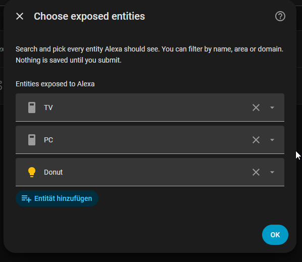
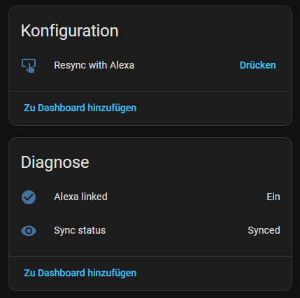
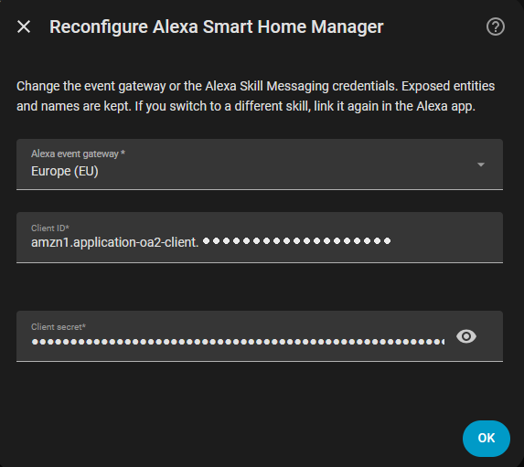

# Alexa Smart Home Manager

Manage which entities Alexa can see from the Home Assistant UI, for people who
run their own Alexa Smart Home skill.

Home Assistant's `alexa: smart_home:` setup lives in `configuration.yaml`. Every
change to the entity list needs a YAML edit and a restart, and then you have to
make Alexa notice, either by re-enabling the skill or by saying "Alexa, discover
devices". This integration replaces that part. Pick entities in a list, give them
Alexa names, save. The change is live immediately and Alexa is told about it.

It does **not** replace the skill itself. You still create the skill and the
Lambda function once, exactly as Home Assistant documents it.

## How it works

The integration takes over the `/api/alexa/smart_home` endpoint that the YAML
setup would normally provide. Your Lambda function keeps talking to Home
Assistant as before. Exposure and names are read live from the integration's
settings, so there is nothing to reload.

When you save, it compares the result with what Alexa was last told and sends
Alexa only the difference: new or renamed entities as an `AddOrUpdateReport`,
removed ones as a `DeleteReport`. What Alexa was last told is stored, so
restarting Home Assistant does not resend everything.

## Features

- Searchable entity picker (filter by name, area or domain)
- Optional Alexa name per entity, shown next to its Home Assistant name and area
- Rejects two entities with exactly the same Alexa name. Similar names are fine.
- Changes apply instantly, no restart, no reload
- Automatic discovery push to Alexa on every change, and right after the skill
  is linked
- Follows entity ID renames and tells you about exposed entities that no longer
  exist
- Reconfigure credentials without losing your entities
- Status entities and a resync button

## Requirements

- A working Alexa Smart Home skill and Lambda function, set up following
  [Home Assistant's Alexa Smart Home guide](https://www.home-assistant.io/integrations/alexa.smart_home/).
  That guide is long and I don't repeat it here.
- Home Assistant reachable from the internet over HTTPS, as that guide requires.
- Client ID and Client secret from **Alexa Skill Messaging** in the skill's
  permissions. These are *not* the Account Linking values.

Everything in the guide applies except the `alexa: smart_home:` block in
`configuration.yaml` (see the next section). If you already finished the guide,
you don't have to set anything up again.

## If you already use `alexa: smart_home:`

Remove the `smart_home:` block from `configuration.yaml` and restart Home
Assistant. Other `alexa:` sections such as `flash_briefings` can stay.

Both can't run at once, because they serve the same URL. If the block is still
there, setup fails and Home Assistant shows a repair: "Alexa Smart Home endpoint
already in use".

Copy your old `filter` and `entity_config` names into this integration first,
because they are not imported.

## Installation

### HACS

1. HACS → three dots → **Custom repositories**
2. Add `https://github.com/Knabbiii/alexa_bridge_manager` as category
   **Integration**
3. Install **Alexa Smart Home Manager** and restart Home Assistant

### Manual

Copy `custom_components/alexa_bridge_manager` into the `custom_components`
folder of your Home Assistant configuration and restart.

## Setup

1. Settings → Devices & services → Add integration → **Alexa Smart Home Manager**
2. Pick your Alexa region and enter the Client ID and Client secret.
   For a gateway that isn't listed, choose *Custom URL*.
3. In the Alexa app, enable or re-link your skill. Linking is what lets Home
   Assistant talk to Alexa, so exposed entities are pushed as soon as it
   completes.
4. Open **Configure** on the integration, pick entities, optionally name them,
   and save.



If a device doesn't show up in Alexa, check the sync status entity and press
**Resync with Alexa**.

## Entities

| Entity | Description |
| --- | --- |
| `binary_sensor.alexa_smart_home_manager_alexa_linked` | On once Alexa has completed account linking |
| `sensor.alexa_smart_home_manager_sync_status` | `not_linked`, `pending`, `synced` or `error`, with `last_success` and `last_error` attributes |
| `button.alexa_smart_home_manager_resync_with_alexa` | Resends every exposed entity to Alexa |



Entity IDs are derived from the device name. On older installations they start with `alexa_bridge_manager_`.

## Changing credentials

Use **Reconfigure** in the integration's menu to change region, Client ID or
Client secret. Don't delete and re-add the integration: removing it tells Alexa
to forget all exposed devices.



## Known limitations

- Only one instance, matching the one endpoint a skill has.
- Exposed entities are reported to Alexa with the `en-US` locale.
- Settings from an existing `alexa: smart_home:` block are not imported.
- Names are unique per entity, but Alexa can still confuse names that sound
  alike. Only exact matches are blocked.
- The client credentials are checked for their expected format only. A wrong
  value shows up as a failed sync, not at setup.

## Troubleshooting

**Sync status is `not_linked`.** Alexa hasn't completed account linking yet.
Open the skill in the Alexa app and link it.

**Sync status is `error`.** The `last_error` attribute has the reason. Common
causes are credentials from the wrong place (Account Linking instead of Skill
Messaging) or an outdated link. Disable and enable the skill in the Alexa app,
then press **Resync with Alexa**.

**"Alexa Smart Home endpoint already in use".** A `smart_home:` block is still in
`configuration.yaml`. See above.

**Debug logging:**

```yaml
logger:
  logs:
    custom_components.alexa_bridge_manager: debug
    homeassistant.components.alexa: debug
```

Diagnostics can be downloaded from the integration's menu. Client ID and secret
are redacted.

## Development

```bash
pip install -r requirements_test.txt
python -m pytest tests/ -q
```

## Issues

Bug reports and feature requests are welcome in the
[issue tracker](https://github.com/Knabbiii/alexa_bridge_manager/issues). Please
attach the diagnostics download and the debug log.
